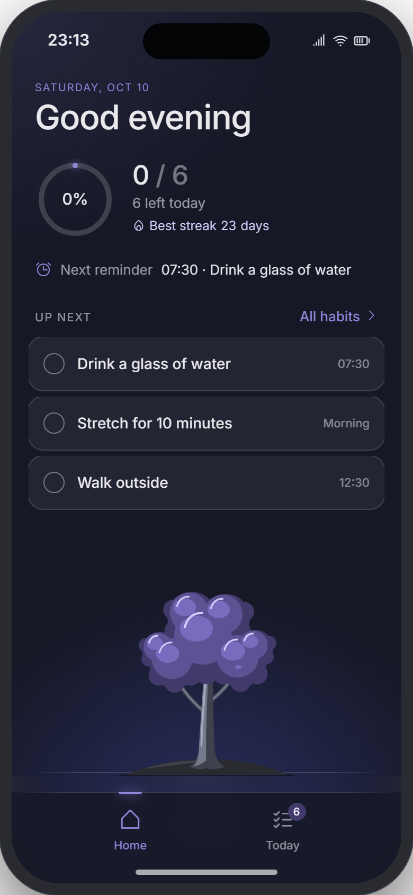
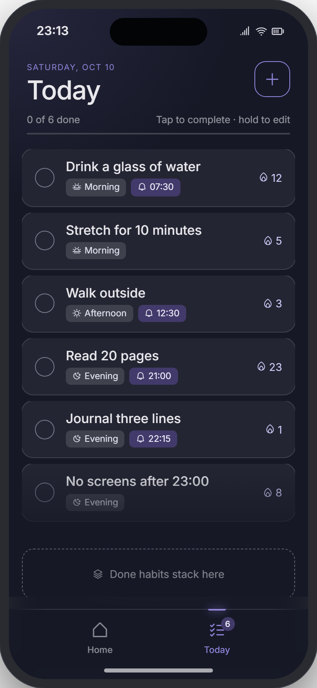
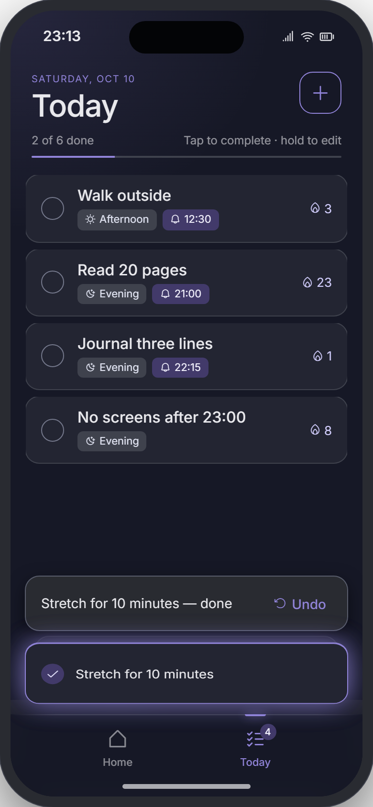
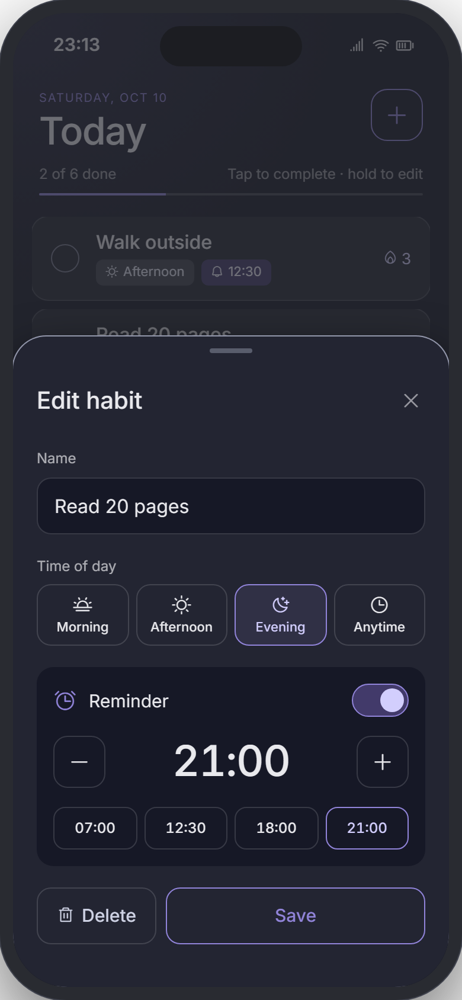
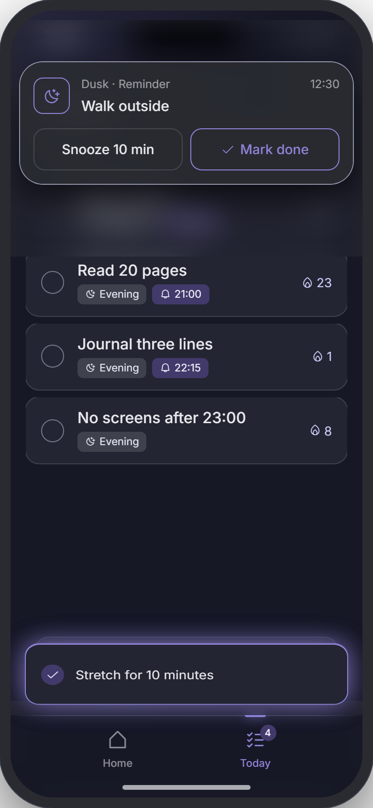

# Dusk — daily habit tracker

A dark, calm habit tracker built with **Expo (SDK 57) + React Native + TypeScript**, recreated from the
high‑fidelity design handoff in [`design/`](design/README.md).

Keep a daily checklist, tap a habit to complete it (it flips over and drops onto a "done" pile), hold to edit,
set per‑habit reminders, and watch a tree on Home grow with your best streak.

| Home | Today | Done pile | Edit sheet | Reminder |
| --- | --- | --- | --- | --- |
|  |  |  |  |  |

_(Design reference screenshots.)_

## Run it

```bash
npm install
npx expo start          # then press i / a, or scan the QR code with Expo Go
npx expo start --web    # browser preview
```

Everything used ships in Expo Go, so no development build is needed to try it. For store builds use EAS
(`npx eas-cli@latest build`).

```bash
npm run typecheck       # tsc --noEmit
npm run lint            # expo lint
```

## What's implemented

- **Home** — date kicker + time‑of‑day greeting, animated progress ring, best streak, next reminder,
  "Up next" (first three habits, tap to complete) and the procedural tree.
- **Today** — full list (tap to complete · hold 480 ms to edit), progress line, `+` to add, done pile with
  up to `pileDepth` back layers, "Every habit done" celebration (ring pop, halo, 34‑particle burst) and the
  empty state.
- **Completion flip** — the card is measured, a ghost copy flips (perspective 800, rotateX → −180°) along an
  arc onto the pile, or into the Today tab icon when completed from Home, while the original row collapses.
  Light haptic on landing; Undo toast re‑inserts the habit at its original index with a flip‑in.
- **Edit / Add sheet** — name (with shake + message when empty), time‑of‑day tiles, reminder switch, ±15 min
  stepper (wraps 24 h) and presets, Delete / Save.
- **Reminders** — one daily local notification per habit (`expo-notifications`), rescheduled whenever a
  reminder, time or name changes and cancelled on delete. Notifications carry **Snooze 10 min** and
  **Mark done** actions. While the app is open a reminder shows as the in‑app banner instead.
- **Tree** — seed → sprout → leafy stem → small tree → tree → full tree at best streak 0 / 1 / 7 / 14 / 30 / 100,
  ported from `plantArtPainted()` to `react-native-svg`. Idle sway, leaf flutter, canopy breathe, glowing
  buds, falling leaves and fireflies run from one Reanimated frame clock; tap (or complete from Home) for a
  rustle + sparkles; growing a stage pops the tree.
- **New day** — at local midnight (and on returning to the foreground) completed habits extend their streak,
  missed ones reset to 0 (as does any gap of 2+ days), the pile clears and the original order returns.
- **Persistence** — habits, today's done list (with its date), streaks and settings are saved with
  AsyncStorage.
- **Reduce Motion** — idle loops stop and one‑shot effects fall back to simple fades.

## Project layout

```
src/
  app/                    Expo Router routes
    _layout.tsx           fonts, providers, global overlays, lifecycle hooks
    (tabs)/_layout.tsx    tabs with cross-fade + 28px slide
    (tabs)/index.tsx      Home
    (tabs)/today.tsx      Today
  components/
    HabitCards.tsx        card faces, Today/Up-next rows, collapse + undo re-entry
    GhostLayer.tsx        the completion flip
    DonePile.tsx, AllDone.tsx, EditSheet.tsx, TabBar.tsx, Overlays.tsx (toast + reminder banner)
    tree/                 tree geometry (art.ts) and animated rendering (Tree.tsx)
  state/store.ts          zustand store (persisted) — habits, done list, streak/new-day logic
  lib/                    completion orchestration, notifications, time helpers, view registry
  theme/tokens.ts         Nocturne tokens (colors, radii, elevation, type, easing)
design/                   original design handoff (README, prototype HTML, token CSS, screenshots)
```

## Notes

- **Settings** — `animSpeed` (Gentle / Normal / Snappy), `pileDepth` (1–5) and `timeFormat` (24h / 12h) are
  part of the persisted state with the design's defaults; the design has no settings screen, so there is no
  UI for them yet (`useStore.getState().updateSettings(...)`).
- **Dev shortcuts** (development builds only, standing in for the prototype's top‑bar controls): long‑press
  the date on **Home** to show the reminder banner; long‑press the title on **Today** to run the new‑day logic.
- The **Snooze** notification action doesn't open the app, so if the OS has fully killed Dusk it may not run.
  A daily reminder for a habit already done today is hidden while the app is open, but the OS can still
  deliver it in the background.
- Seed data matches the handoff: six habits with streaks 12 / 5 / 3 / 23 / 1 / 8.
